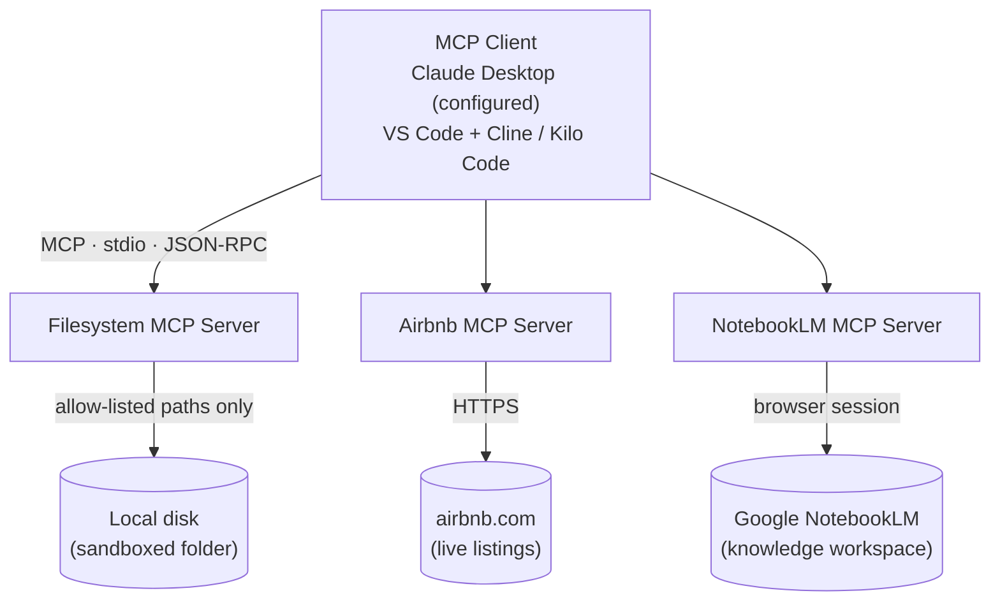
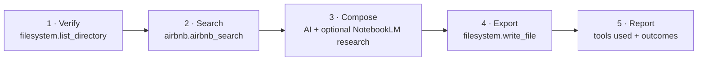

# MCP Multi-Server AI Assistant

[](LICENSE)
[](https://modelcontextprotocol.io)


**Author:** Ajim Sikandar Mujawar
**Intended repository (not yet created):** `https://github.com/ajimmujawar44/mcp-multi-server-ai-assistant`

---

## Overview

A hands-on project exploring **Model Context Protocol (MCP)** across three specialized servers — filesystem operations, Airbnb accommodation search, and NotebookLM research — driven by a single MCP client (**Claude Desktop**, configured locally; VS Code + Cline / Kilo Code also documented). Servers run over stdio (JSON-RPC), launch on demand via `npx`, and follow a **grounded-output rule**: when a live service fails, the report says so instead of inventing data.

The repository ships the documentation of that work: architecture and setup guides, a verification report, a sanitized example config, and a sample end-to-end output — all credential-free by design.

## Status at a Glance

| Component | Status | Evidence |
|---|---|---|
| **Filesystem MCP** | ✅ Tested | `hello.txt` local test + checks F1–F4 (list/write/verify, sandbox deny) — [tests/test_results.md](tests/test_results.md) |
| **Airbnb MCP — connector** | ✅ Tested | Tool registration & call routing (A1–A3) |
| **Airbnb MCP — live search** | 🔄 In Progress | No successful live search yet — upstream parser error (reproduced 3×) |
| **NotebookLM MCP** | 🔄 Auth incomplete | Server healthy (`get_health` → `status: "ok"`, N1–N3); Google sign-in **not completed** — no authenticated research claimed |
| **End-to-end travel plan (2026-10-08)** | ⚠️ Partial run | Plan exported via Filesystem MCP with transparent search-failure reporting — [sample output](outputs/mumbai_travel_plan.md) |
| **Claude Desktop + Node.js/`npx`** | ✅ Implemented | Local setup by the author |
| **Screenshots** | 📋 Planned | Pending capture and review |

## Existing MCP Setup and Test Evidence

Setup already completed on the local machine (outside this repository):

| Item | What is in place |
|---|---|
| **MCP client** | **Claude Desktop**, configured with this project's `mcpServers` block (same structure as [config/mcp_config.example.json](config/mcp_config.example.json)) |
| **Runtime** | Node.js (≥ 18) with `npx` available — servers launch without a local install |
| **Local testing directory** | `C:\Azim` — a scratch directory **separate from this repository** (see note below) |
| **Filesystem MCP test** | Tested with a file named **`hello.txt`** — basic file operations confirmed through the MCP client |
| **Airbnb connector test** | **Connector test performed** — tool registration and client→server call routing confirmed (matches checks A1–A2 in [tests/test_results.md](tests/test_results.md)) |

> **About `C:\Azim`:** this is the local testing directory where hands-on experiments (such as `hello.txt`) run. It is intentionally **not** part of the repository, and its contents have **not** been copied into `tests/`, `outputs/`, or anywhere else in this project. The repository carries the *documentation* of the work instead: example configuration, test results, sample outputs, and (planned) reviewed screenshots — the durable record of what was built and verified.

> **Connector test ≠ live search:** a successful *connector test* proves the Airbnb tool is registered and callable and that requests reach the server. It does **not** prove that live listings can be retrieved. Live listing retrieval currently fails with an upstream parsing error and remains **unverified** until a successful live search is recorded.

## Architecture



*Every tool call flows client → server → external resource and back. Servers are launched by the client via `npx` from a single settings file. Full detail: [docs/architecture.md](docs/architecture.md).*

## Workflow — Mumbai Travel Planner



Paste-ready workflow: [workflows/travel_planner.md](workflows/travel_planner.md).

## Packages & Technologies

| Layer | Technology |
|---|---|
| Protocol | **MCP** over stdio (JSON-RPC) |
| Host / editor | **VS Code** |
| AI client (MCP client) | **Claude Desktop** (configured); Cline / Kilo Code extension (documented alternative) |
| Filesystem server | **`@modelcontextprotocol/server-filesystem`** (official MCP reference server) |
| Accommodation server | **`mcp-server-airbnb`** (community implementation, as used during testing) |
| Research server | **`notebooklm-mcp`** (npm, by PleasePrompto — browser automation via Patchright) |
| Runtime | **Node.js ≥ 18** launched through **`npx`** (no local install required) |
| Output format | Markdown |

> Package names follow [config/mcp_config.example.json](config/mcp_config.example.json); [docs/setup.md](docs/setup.md) notes they are illustrative — substitute the exact implementations you install.

## Repository Structure

```
mcp-multi-server-ai-assistant/
├── config/mcp_config.example.json   # sanitized example config
├── docs/                            # architecture · setup · troubleshooting
├── workflows/travel_planner.md      # main workflow
├── tests/test_results.md            # verification report
└── outputs/mumbai_travel_plan.md    # sample output (real test run)
```

> Planned, not yet added: `screenshots/`. Local test artifacts (`hello.txt`, etc.) live in `C:\Azim` and are **not** part of this repository.

## Setup (Windows)

1. Install **VS Code**, an MCP client (**Claude Desktop**, or the Cline / Kilo Code extension), and **Node.js 18+**.
2. Copy the `mcpServers` block from [`config/mcp_config.example.json`](config/mcp_config.example.json) into your client's MCP configuration — Claude Desktop and `cline_mcp_settings.json` use the same JSON structure.
3. Replace `C:\Users\YourName\Documents\mcp-outputs` with a dedicated folder — the **only** folder the Filesystem server can touch.
4. Reconnect the MCP servers and run the checks in [tests/test_results.md](tests/test_results.md).

> Keep `timeout` ≥ 600 s on the `notebooklm` server for interactive sign-in. Full guide: [docs/setup.md](docs/setup.md) · Fixes: [docs/troubleshooting.md](docs/troubleshooting.md)

**Configuration:** use the sanitized [`config/mcp_config.example.json`](config/mcp_config.example.json) — no secrets, same JSON structure for Claude Desktop and `cline_mcp_settings.json`. Keep `autoApprove` minimal; set the `notebooklm` `timeout` ≥ 600 s.

## Testing & Verification

Full details: [tests/test_results.md](tests/test_results.md) (run **2026-10-08**, Windows / VS Code / Cline-style client).

**Suite summary:** Filesystem F1–F4 ✅ (list/write/verify, sandbox deny) · Airbnb A1–A4 ✅ (integration; live search ❌ — upstream parser error) · NotebookLM N1–N4 ✅ (health/maintenance; **auth not completed**) · Workflow W1–W3 ✅ (**partial run**). Re-verified 2026-10-09: `get_health` → `status: "ok"`.

**Local tests (in `C:\Azim`, outside the repo suite):** Filesystem MCP with `hello.txt`; Airbnb connector test (registration + call routing only).

## Security

- **Sandboxed file access** — the Filesystem server only sees folders listed in its launch `args`; anything else returns `Access denied - path outside allowed directories`.
- **Minimal auto-approval** — `autoApprove` lists only the tools each workflow needs.
- **No secrets in git** — `.gitignore` excludes `.env*`, cookies, credentials, tokens, browser profiles, and personal MCP client settings; auth data stays in OS app-data.
- **Grounded outputs** — generated documents contain only retrieved data; failures are reported, never fabricated.

## Known Limitations

- **Airbnb live listings** — upstream page-structure change breaks the parser; no successful live search yet.
- **NotebookLM auth** — interactive Google sign-in incomplete (600 s client timeout equals the sign-in window). Mitigation: raise `timeout` (≥ 900) and run `setup_auth` with `show_browser: true` ([troubleshooting §3–4](docs/troubleshooting.md)).
- **Screenshots** — `screenshots/` planned, not yet created.

## Future Improvements

- [ ] Fix or replace the Airbnb server to retrieve live listings
- [ ] Complete NotebookLM authentication and add grounded research to the workflow
- [ ] Add reviewed screenshots in `screenshots/`
- [ ] CI for documentation lint and config validation

## License

Released under the **MIT License** — see [LICENSE](LICENSE).

---

**Ajim Sikandar Mujawar** · Intended repository: `https://github.com/ajimmujawar44/mcp-multi-server-ai-assistant` (not yet created)
